<p align="center">
  
</p>

<p align="center">
  <a href="https://www.linkedin.com/in/fedevillon"></a>
  
  
</p>

---

### `> sobre mí`

Estudio **Ingeniería en Sistemas de Información** en la UTN. Me interesan el **soporte técnico**, los **datos** y la **automatización de procesos**: entender cómo funciona un negocio y armar herramientas simples que le ahorren tiempo y errores.

```yaml
soporte:     [hardware, diagnóstico, redes, Linux (Debian), SSH]
datos:       [SQL, Excel, reportes]
desarrollo:  [Python, Flask, HTML, CSS, JavaScript]
forma_de_trabajo: "planifico, uso IA para acelerar, reviso y documento"
```

### `> proyectos`

<table>
<tr>
<td width="50%" valign="top">

**🧾 [Despensa](https://github.com/fede-villon/despensa)**<br>
Stock, caja y reportes para almacenes de barrio: alertas de stock bajo y vencimientos, compras a proveedores, roles y exportación a Excel.<br><br>
<code>Python</code> <code>Flask</code> <code>SQLite</code> <code>pytest</code>

</td>
<td width="50%" valign="top">

**📥 [Bandeja](https://github.com/fede-villon/bandeja)**<br>
Lee facturas y remitos de proveedores con IA, controla totales, duplicados y aumentos de precio, y arma panel, Excel y resumen semanal.<br><br>
<code>Python</code> <code>Claude API</code> <code>SQLite</code> <code>Excel</code>

</td>
</tr>
<tr>
<td width="50%" valign="top">

**🎮 [Campus Backend Developer](https://github.com/fede-villon/CampusBackendDeveloper)**<br>
App web gamificada para aprender backend con misiones, niveles y ejercicios de Python en el navegador.<br><br>
<code>PWA</code> <code>JavaScript</code> <code>Pyodide</code>

</td>
<td width="50%" valign="top">

**🏋️ [Training App](https://github.com/fede-villon/training-app)**<br>
App de entrenamiento y seguimiento que funciona sin conexión y guarda los datos en el dispositivo.<br><br>
<code>PWA</code> <code>JavaScript</code> <code>IndexedDB</code>

</td>
</tr>
</table>

### `> stack`

<p>
  
  
  
  
  
  
  
  
  
  
  
</p>

<p align="center"><sub>$ echo "gracias por pasar" ▍</sub></p>
